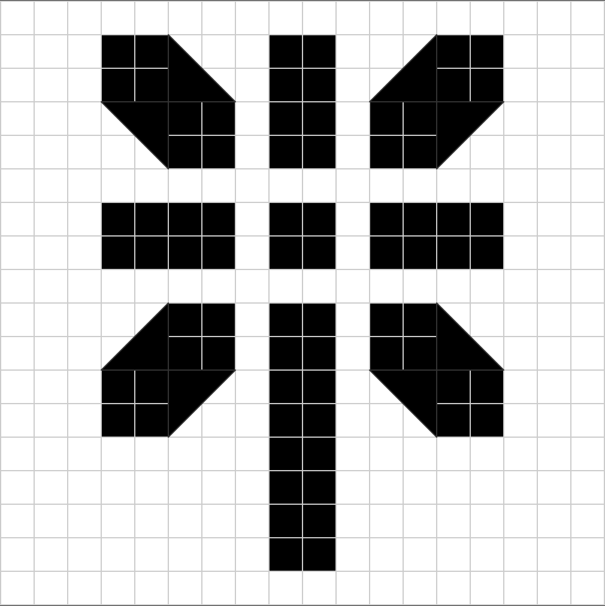
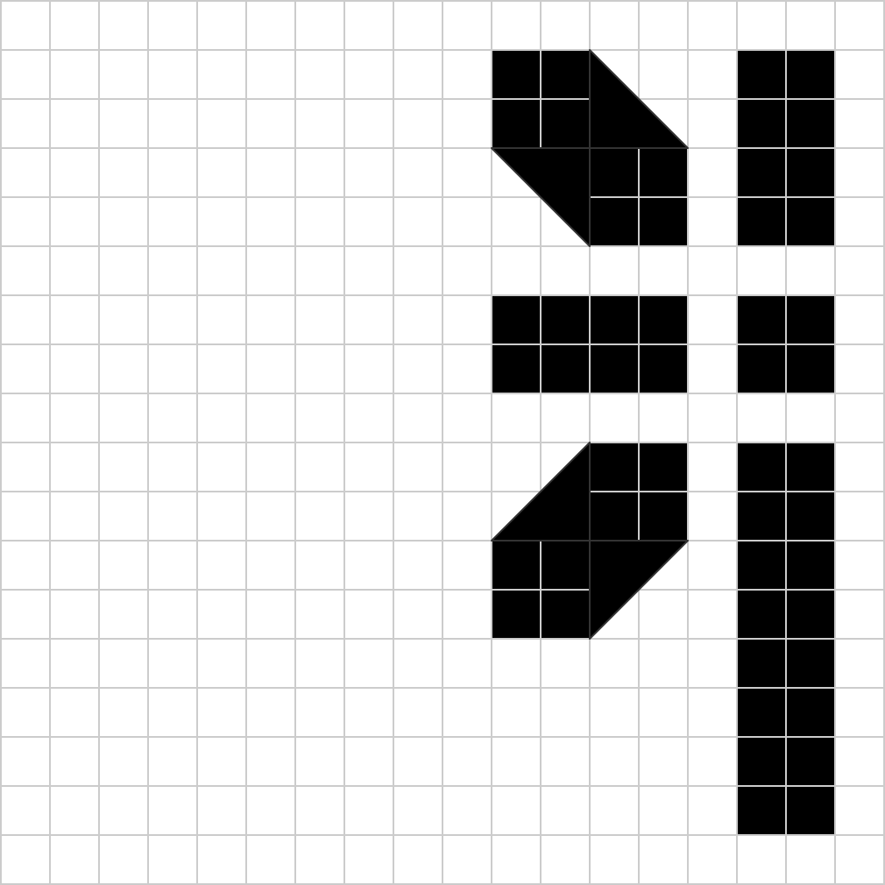
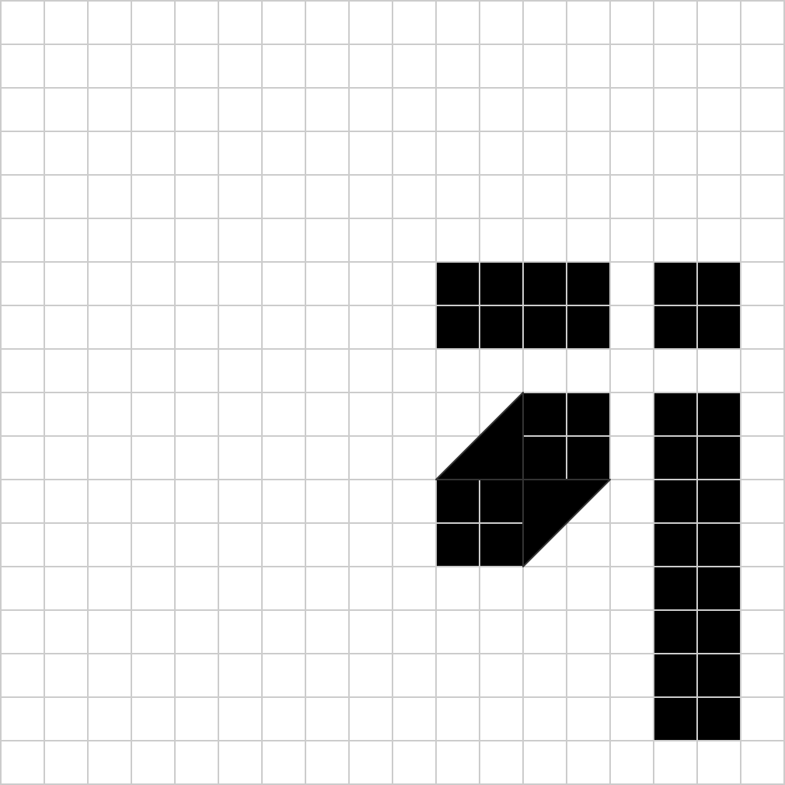
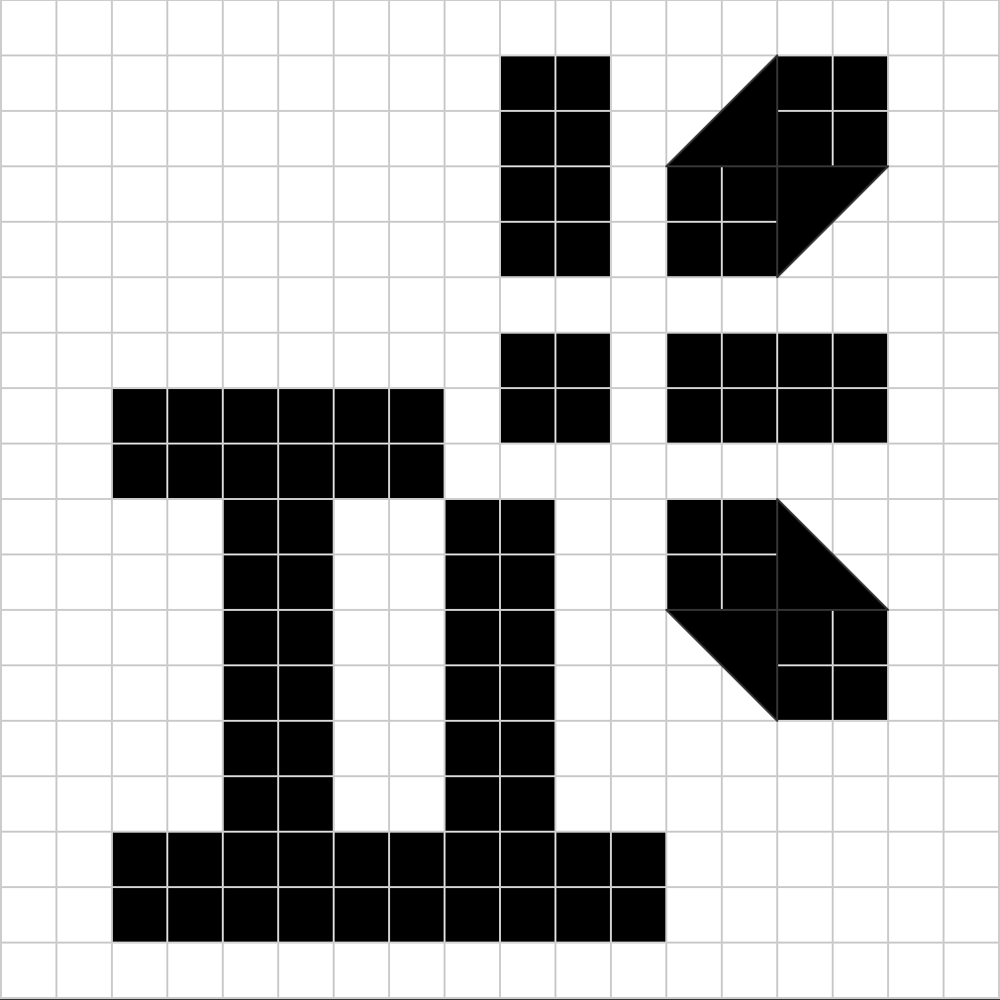

# winisi
information about my icon and logo design language.

## 1. main logo
my logo represents a flower, a dandelion, or a clock.
### 1.1 default logo

grid reference

### 1.2 half-cut logo

grid reference

### 1.3 corner-cut logo

grid reference

## 2. "2" logo
half-cut variant with number two
### 2.1 "2" logo

grid reference

